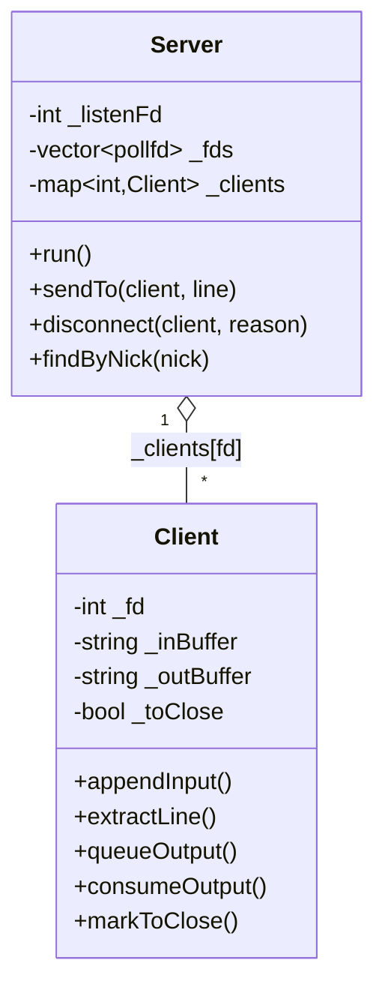
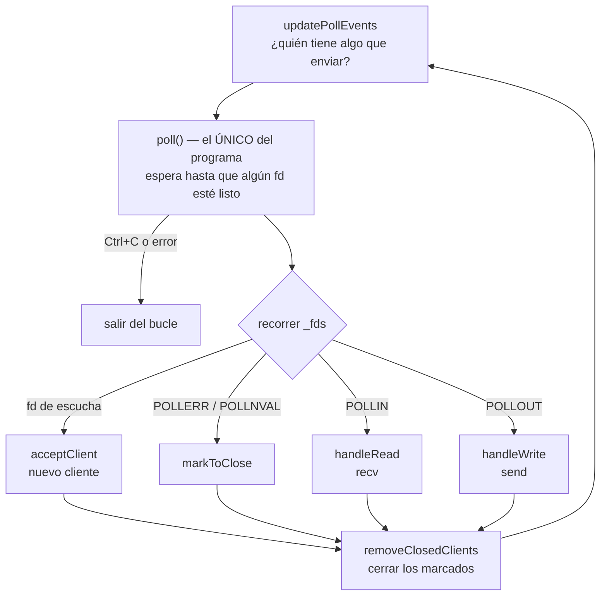
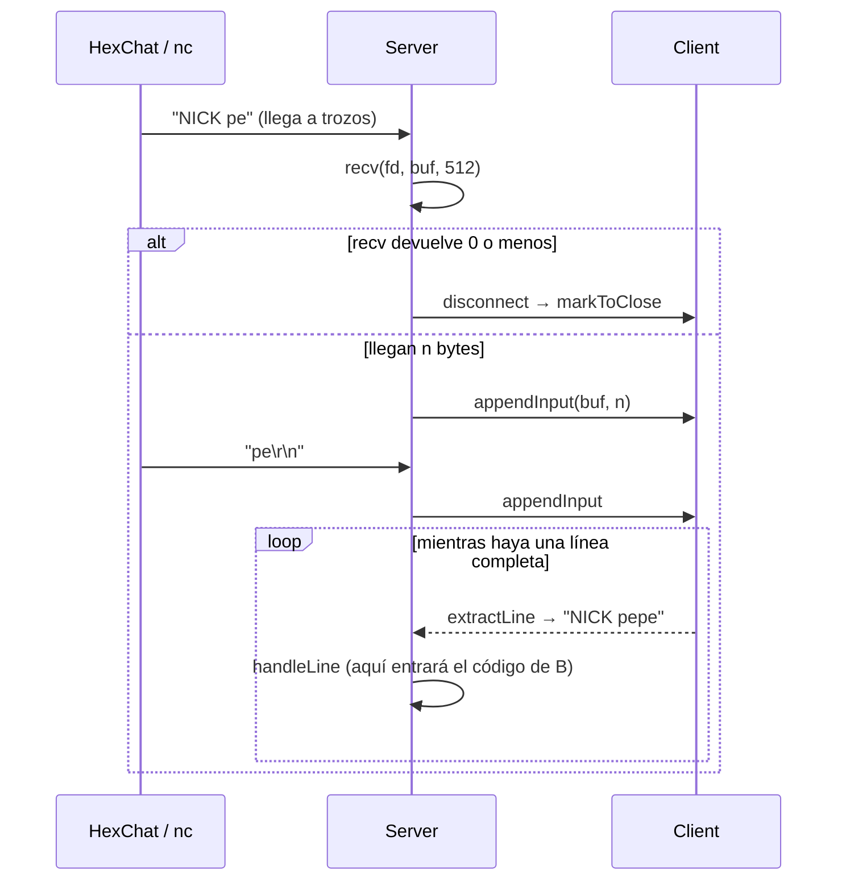
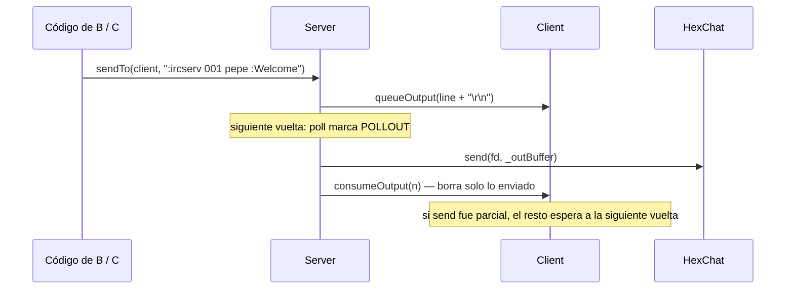
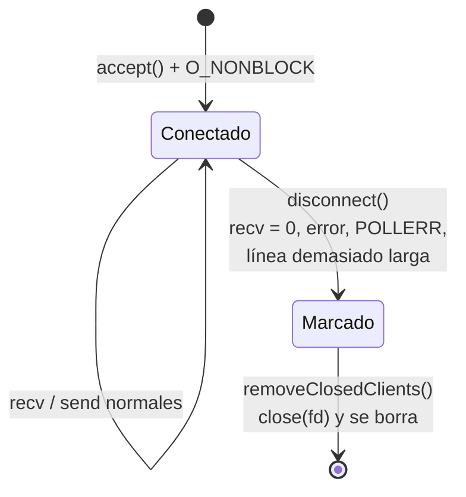

# Parte de red (Persona A)

Archivos: `srcs/main.cpp`, `srcs/Server.cpp`, `srcs/Client.cpp`, `includes/Server.hpp`, `includes/Client.hpp`.

Idea en una frase: **un único `poll()` vigila todos los sockets; cuando uno está listo, leemos o
escribimos sin bloquear, y nunca cerramos a un cliente en mitad de la vuelta.**

---

## 1. Quién es quién (clases)

- **Server**: el que escucha, acepta y reparte. Es el único que llama a `poll`, `recv` y `send`.
- **Client**: un usuario conectado. Guarda **dos buffers**:
  - `_inBuffer`: lo que nos llegó y aún no forma una línea completa.
  - `_outBuffer`: lo que queremos enviarle y aún no ha salido.
- `_fds` es el array que le pasamos a `poll()`. La posición `[0]` es siempre el socket de escucha.

---

## 2. El bucle principal (`Server::run`)

Explicación paso a paso:
1. **updatePollEvents**: a todos les pedimos `POLLIN` (avísame si me escriben). `POLLOUT` solo a
   quien tiene algo en `_outBuffer`. Si se lo pidiéramos a todos, `poll` volvería al instante → 100 % CPU.
2. **poll**: el programa se duerme aquí hasta que pase algo. Por eso no gasta CPU.
3. **Recorremos** los fds que tienen `revents` distinto de 0 y hacemos lo que toque.
4. **removeClosedClients**: al final, y solo al final, cerramos a los marcados. Así nadie borra
   un cliente mientras otro trozo de código lo está usando.

---

## 3. Leer: de bytes a líneas IRC (`handleRead`)

- TCP **no respeta mensajes**: "NICK pepe\r\n" puede llegar en varios trozos, o dos comandos
  juntos en un solo `recv`. Por eso acumulamos en `_inBuffer` y solo sacamos líneas terminadas en `\n`.
- Aceptamos `\r\n` (clientes IRC) y `\n` solo (`nc` sin `-C`).
- Si `_inBuffer` pasa de 1024 bytes sin un `\n`, desconectamos: protege contra quien manda basura sin fin.
- **No miramos `errno`** (lo prohíbe el subject): solo el valor que devuelve `recv`.

---

## 4. Escribir: nunca enviamos directamente (`sendTo` → `handleWrite`)

- `sendTo` **no envía**: solo deja el mensaje en la cola (`_outBuffer`).
- El `send` real ocurre cuando `poll` dice que ese socket puede escribir (regla del subject:
  nunca `send` sin que `poll` lo marque listo).
- `send` puede enviar solo una parte. Borramos lo enviado y el resto sale en la siguiente vuelta.

---

## 5. Vida de un cliente (estados de red)

- **Marcado** = `_toClose = true`. El cliente sigue en memoria hasta el final de la vuelta.
- El registro (PASS/NICK/USER) es otro estado que lleva **B**; aquí solo está la parte de red.

---

## 6. Contrato con B y C

B y C **nunca** llaman a `recv`, `send` ni `close`. Solo usan:

| Función | Qué hace |
|---|---|
| `sendTo(client, line)` | Encola `line + "\r\n"`. No pongáis `\r\n` vosotros. |
| `disconnect(client, reason)` | Marca para cerrar al final de la vuelta. |
| `findByNick(nick)` | Busca sin distinguir mayúsculas. `NULL` si no existe. |
| `getPassword()` | La contraseña de `./ircserv <port> <password>`. |

Pendiente de integrar:
- **B**: `handleLine` pasará a llamar a `CommandHandler::execute(...)`.
- **C**: en `removeClosedClients`, sacar al cliente de sus canales antes de borrarlo.

---

## 7. Señales (`main.cpp`)

- **SIGPIPE ignorado**: si enviamos a un cliente que ya cerró, el sistema mandaría SIGPIPE y
  mataría el servidor. Ignorándolo, `send` solo devuelve -1 y desconectamos a ese cliente.
- **SIGINT (Ctrl+C)**: pone `g_running = false`; `poll` se interrumpe y salimos limpio
  (el destructor cierra todos los fds).
